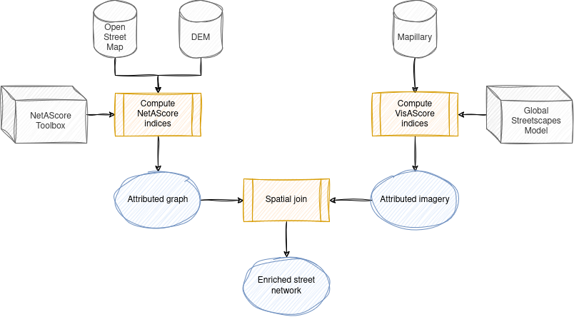
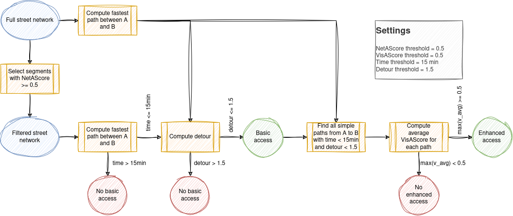

# Theory and methods

This guide summarizes the theory and the methods that lie at the basis of the computations. The main aim of the software is to compute more human-centred metrics of active transport accessibility, by quantifying different aspects of how humans perceive the environment, and allowing variables to be tuned to individual needs and preferences.

We understand accessibility as something that is inherently shaped by human perceptions. The experienced quality of the street environment along a route to a destination strongly influences the extent to which the destination itself can be considered accessible. Street environment quality has aspects of safety, comfort, and enjoyment. We treat those three as latent variables that cannot be fully nor directly measured, but approximated partly through measurable indicators.

Safety and comfort are primarily about the reduction of negative experiences, while enjoyment is about the enhancement of positive experiences. They do not operate on an equal level. Rather, they form a pyramid. Safety lies at the bottom, while enjoyment sits at the top: safety is a prerequisite for enjoyment. This means that, by definition, we not balance indicators of safety, comfort and enjoyment in a single index. Instead, we implement a hierarchy of two indices: basic accessibility and enhanced accessibility.

**Basic accessibility:**
- Reaching a destination within 15 minutes on sufficiently safe and comfortable streets, without taking a large detour from the shortest route.
- Focus on reducing negative experiences.
- Lies at the bottom of the pyramid: sufficient safety and comfort are paramount, non-negotiable.
- If a route if sufficiently safe and comfortable is defined by computing a NetAScore (network assessment score) index for every street segment.
- An index threshold is applied to every individual segment: an unsafe segment cannot be balanced out by a safer segment elsewhere.

**Enhanced accessibility:**
- Reaching a destination within 15 minutes through an environment that is decently beautiful or lively, without taking a large detour from the shortest route.
- Focus on enhancing positive experiences.
- Comes on top of basic accessibility: enhanced accessibility cannot exist when there is no basic accessibility.
- If a route is decently beautiful or lively is defined by computing a VisAScore (visual assessment score) index for every street segment.
- An index threshold is applied to average values over an entire route: less beautiful or lively segments can be balanced out.

The NetAScore and the VisAScore can be summarized as follows:

**NetAScore:**
- Ranges from 0 (low) to 1 (high).
- Computed as the weighted average of multiple street segment properties, including the speed and volume of motorized traffic and the presence of dedicated cycling or walking infrastructure.
- Indicators are computed by assessing OpenStreetMap attributes and elevation data with the NetAScore Toolbox.
- See: [NetAScore](https://plus-mobilitylab.github.io/netascore-documentation/Home.html)

**VisAScore:**
- Ranges from 0 (low) to 1 (high).
- Computed as the maximum of a beauty and a lively indicator.
- Indicators are computed by assessing Mapillary streetview images with the perception assessment model of Global Streetscapes – which is trained on the Place Pulse 2.0 imagery dataset.
- See: [Global Streetscapes](https://ual.sg/project/global-streetscapes/)

Finally, the computation of accessibility as implemented in the software can be summarized with the following diagram.

Note that while the theory and methods are clear, the implementation of enhanced accessibility computation is still experimental in the current software, and results will not always be meaningful. The code needs more testing, and the input data is prone to the following issues:

- The quantity of Mapillary imagery is often not sufficient to cover every street segment in a city.
- The quality of Mapillary imagery can be quite variable, with some high-quality images, but also lots of low-quality images.

